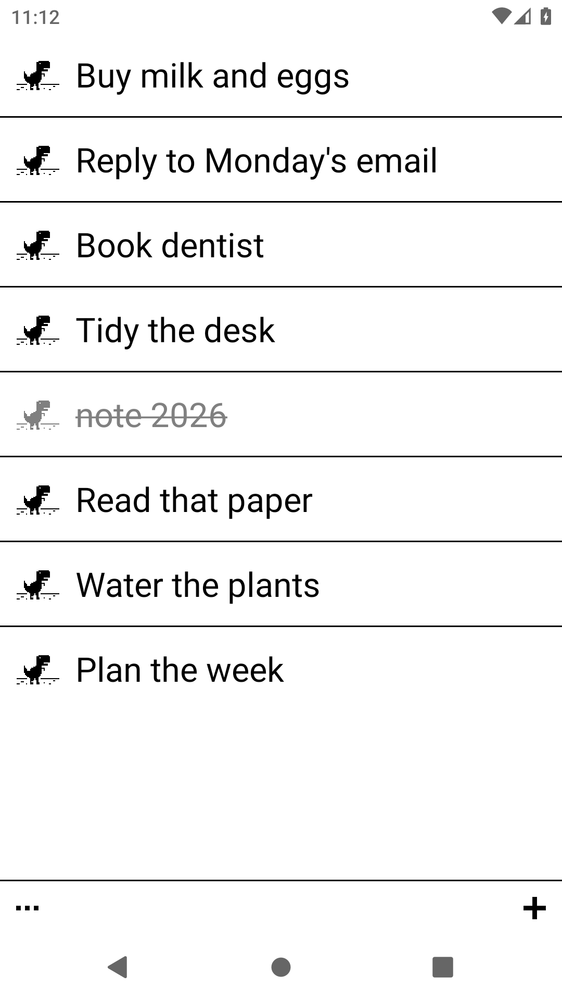
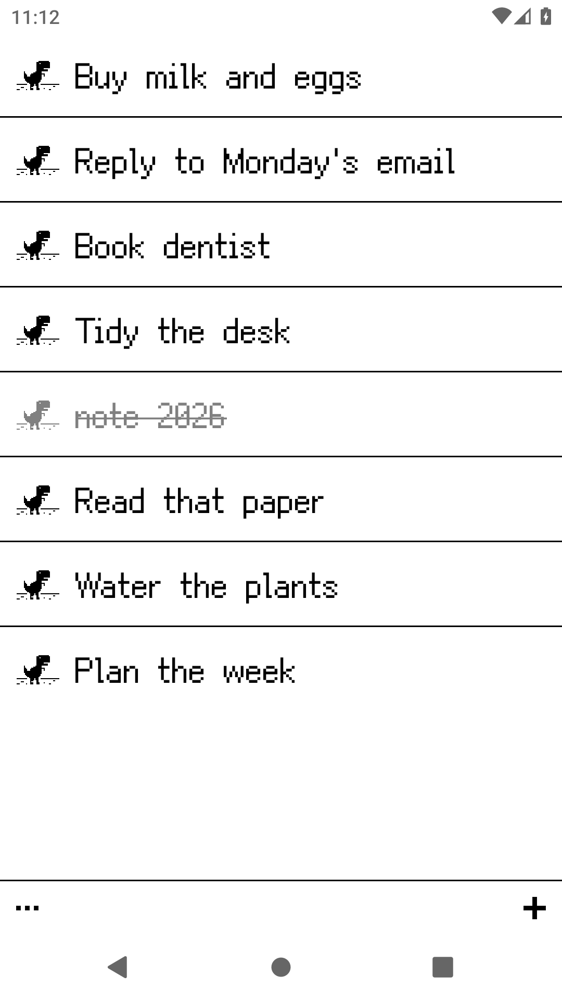
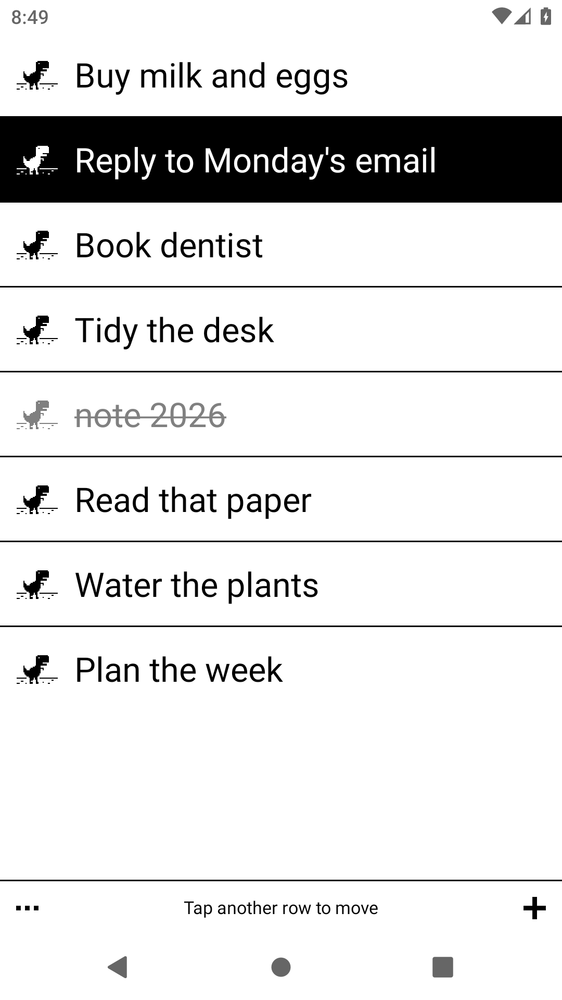

# EinkMemo

**Minimal 1-bit notes for e-ink screens.**

EinkMemo is a tiny notes / to-do app designed for e-ink readers and any Android device where calm, high-contrast UI matters. No accounts, no ads, no background sync, no animations — just a list that stays out of your way.

[简体中文](README.zh-CN.md)



## Highlights

- **Strictly 1-bit**: black and white only, one grey for crossed-off text. No shadows, ripples or transitions — crisp and refresh-friendly on e-ink.
- **Fits any screen**: rows per page adapt to resolution and orientation (3–10 rows); portrait and landscape both work.
- **Fast to use**: swipe right to cross off, tap or swipe left to edit, `+` for continuous adding.
- **Playful detail**: a tiny pixel doodle before every note. Tap the doodle to select a row, then tap another row to swap their positions.
- **Archive**: finished notes stay in place until you archive them from Settings; restore or delete forever from the archive.
- **Manual WebDAV sync**: one `notes.json` on your own NAS. If both sides changed, choose which copy to keep.
- **Keystore-protected credentials**: WebDAV username and password are encrypted with AES-256-GCM via the Android Keystore.
- **Two fonts**: switch between the system font and the bundled pixel font.
- **English and 简体中文** UI, following the system language.

## Install

1. Download the latest `EinkMemo-x.y.z-debug.apk` from [Releases](https://github.com/yuyao110120/EinkMemo/releases).
2. Copy it to your device and open it; allow installing unknown apps if asked.
3. Launch EinkMemo.

The APK is debug-signed for sideloading and needs no Google services.

> **Upgrading from ElinkMemo 0.10 or earlier?** The package id changed to `com.einkmemo.app`, so the new app installs alongside the old one. In the old app run **Sync now** first, then install EinkMemo and sync via WebDAV to pull your notes, and uninstall the old app afterwards.

## Gestures

| Action | Result |
| --- | --- |
| Swipe right on a row | Cross off / undo |
| Tap or swipe left on a row | Edit its text |
| Bottom-right `+` | Add a note (Enter keeps adding) |
| Tap the doodle before a row | Select it, then tap another row to swap |
| Swipe up / down, page or volume keys | Turn page |
| Bottom-left `⋯` | Settings (WebDAV, archive, fonts, help) |

## WebDAV sync

1. Settings → WebDAV: enter the address, username and password. The remote file defaults to `EinkMemo/notes.json`.
2. Tap **Test connection**, then **Save**.
3. Settings → **Sync now**. Sync is manual only; the app never touches the network on launch.

## Fonts

Settings → Font switches between the system font and [Fusion Pixel Font](https://github.com/TakWolf/fusion-pixel-font) (12px proportional, SIL OFL 1.1).

| Pixel font | Selection mode |
| --- | --- |
|  |  |

## Build

Requires JDK 17 and Android SDK 34. The Gradle wrapper is included:

```bash
cd android
./gradlew assembleDebug
```

Output: `android/app/build/outputs/apk/debug/app-debug.apk`. See [docs/BUILD.md](docs/BUILD.md) for the offline toolchain and the release workflow.

## Documentation

- [Specification](docs/SPEC.md) — interaction and visual contract
- [Build & release](docs/BUILD.md) — toolchain, signing, GitHub Actions
- [Prototype](prototype/) — the original HTML design prototype
- [Third-party notices](THIRD_PARTY_NOTICES.md) — bundled fonts and licenses

## License

The app code is released under the [MIT License](LICENSE). Bundled fonts are covered by the SIL Open Font License 1.1; see [THIRD_PARTY_NOTICES.md](THIRD_PARTY_NOTICES.md).