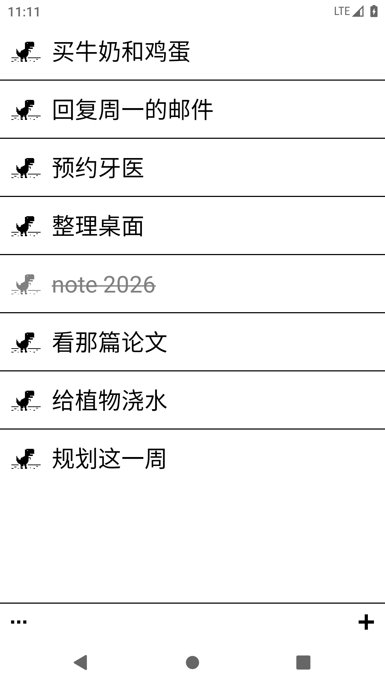

# EinkMemo

**为墨水屏设计的极简 1-bit 便签。**

EinkMemo 是一款小巧的便签 / 待办应用，面向墨水屏阅读器以及其他需要高对比、低干扰界面的 Android 设备。没有账号、广告、后台同步和动画，只有一张安静的清单。

[English](README.md) | 简体中文



## 特点

- **严格 1-bit**：只有黑白，唯一灰色用于已完成；无阴影、无涟漪、无过渡，墨水屏上干净利落
- **适配各种屏幕**：每页行数随分辨率与横竖屏自适应（3–10 行）
- **操作直接**：右滑划掉、点击 / 左滑编辑、`+` 连续新增
- **小趣味**：每条便签前有像素小图；点小图选中该条，再点另一条即可交换位置
- **归档**：已完成的便签原地保留，在设置里手动归档；归档记录可还原或永久删除
- **手动 WebDAV 同步**：NAS 上只有一个 `notes.json`；远端和本机都改动时二选一保留
- **凭据加密**：WebDAV 用户名 / 密码使用 Android Keystore 的 AES-256-GCM 加密保存
- **两种字体**：系统字体与内置像素字体随时切换
- **中英双语**：界面跟随系统语言

## 安装

1. 从 [Releases](https://github.com/yuyao110120/EinkMemo/releases) 下载最新的 `EinkMemo-x.y.z-debug.apk`
2. 拷到设备上打开安装；如提示，请允许「安装未知应用」
3. 打开 EinkMemo

APK 为 debug 签名，可直接侧载，不依赖 Google 服务。

> **从 ElinkMemo 0.10 及更早版本升级？** 包名已改为 `com.einkmemo.app`，新版会作为独立应用安装。请先在旧版里点「立即同步」备份到 NAS，再安装 EinkMemo、配置同样的 WebDAV 并同步拉回笔记，确认无误后卸载旧版。

## 操作

| 操作 | 效果 |
| --- | --- |
| 右滑条目 | 划掉完成 / 再右滑取消 |
| 点击或左滑条目 | 编辑文本 |
| 右下 `+` | 新增；回车保存并继续输入 |
| 点条目前的像素小图 | 选中该条，再点另一条交换位置 |
| 上下滑、翻页 / 音量键 | 翻页 |
| 左下 `⋯` | 设置（WebDAV、归档、字体、帮助） |

## WebDAV 同步

1. 设置 → WebDAV：填写地址、用户名、密码；远端文件默认 `EinkMemo/notes.json`
2. 先点「测试连接」，成功后点「保存」
3. 设置 → **立即同步**。同步仅手动触发，启动 App 时不会联网

## 字体

设置 → 字体：在系统字体与 [Fusion Pixel Font](https://github.com/TakWolf/fusion-pixel-font)（12px proportional，SIL OFL 1.1）之间切换。

| 像素字体 | 选中换位 |
| --- | --- |
|  |  |

## 构建

需要 JDK 17 与 Android SDK 34，仓库自带 Gradle wrapper：

```bash
cd android
./gradlew assembleDebug
```

产物：`android/app/build/outputs/apk/debug/app-debug.apk`。离线工具链与发布流程见 [docs/BUILD.md](docs/BUILD.md)。

## 文档

- [规格说明](docs/SPEC.md)
- [构建与发布](docs/BUILD.md)
- [原型](prototype/)
- [第三方资源](THIRD_PARTY_NOTICES.md)

## 许可

应用代码使用 [MIT License](LICENSE)。内置字体使用 SIL Open Font License 1.1，详见 [THIRD_PARTY_NOTICES.md](THIRD_PARTY_NOTICES.md)。